1. Testing and Local Application Verification 
Pytest: All 23 pytest tests passed successfully on the updated backend dependencies
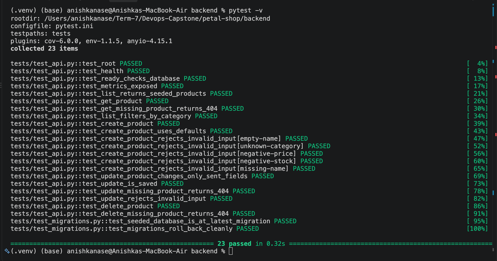 

2. Docker Compose: Ran docker compose up to build and start the application services locally and verify that the frontend, backend, and database containers started successfully.
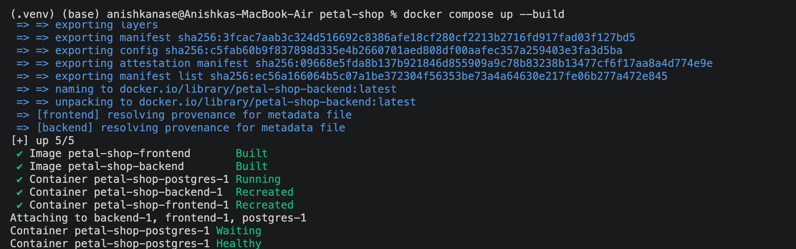

3. Frontend: Verified that the Petal Shop frontend was accessible locally and that the application interface loaded correctly.
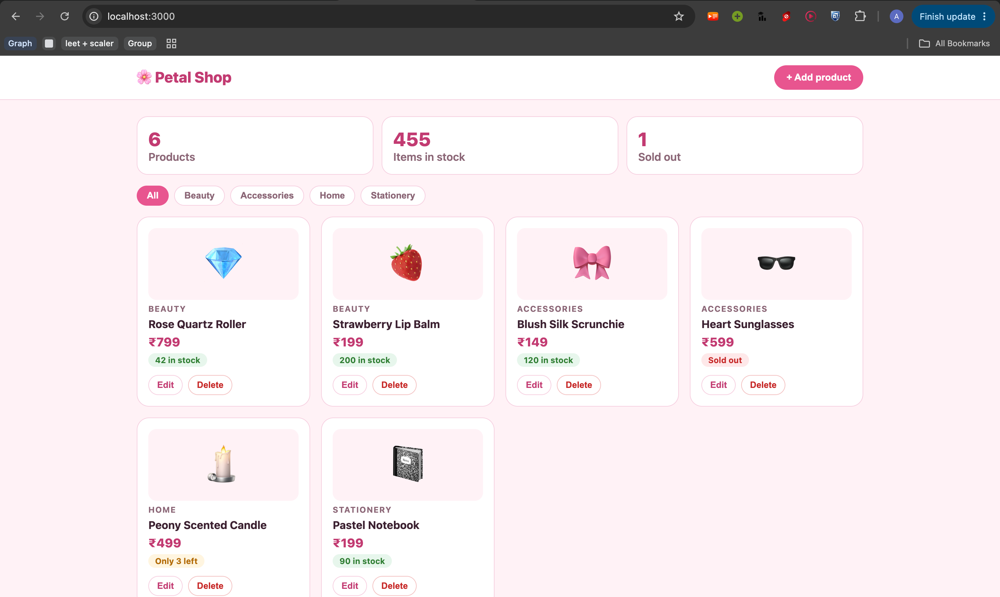

4. CI/CD Pipeline
All CI/CD checks passed successfully. The pipeline executed the build-and-test job, Trivy security scanning, and Docker image build and push steps.
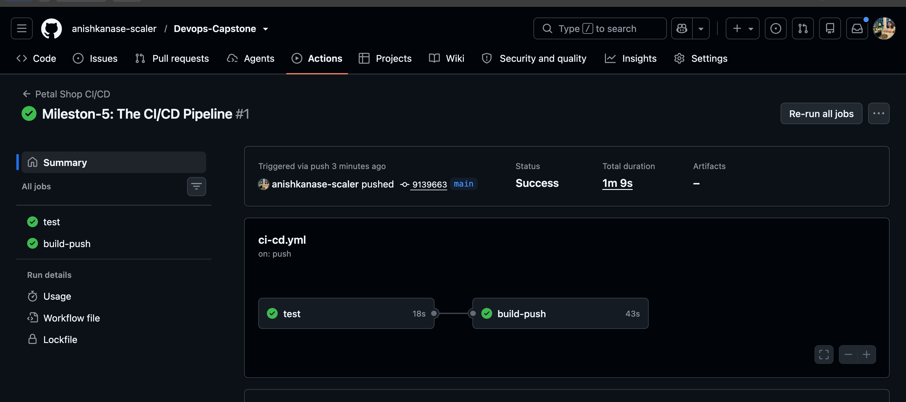

5. Docker Images Published to GHCR: Both frontend and backend Docker images were successfully pushed to GitHub Container Registry (GHCR)

=> Frontend pushed in GHCR
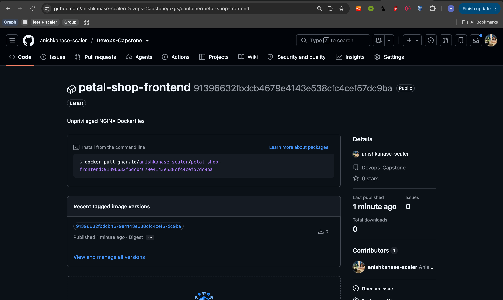
ghcr.io/anishkanase-scaler/petal-shop-frontend:91396632fbdcb4679e4143e538cfc4cef57dc9ba

=> Backend pushed in GHCR
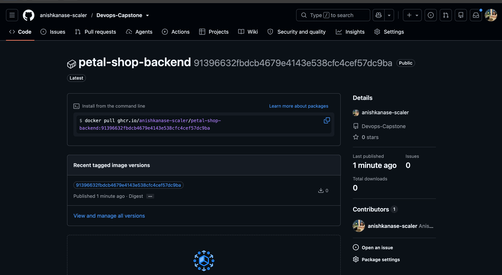
ghcr.io/anishkanase-scaler/petal-shop-backend:91396632fbdcb4679e4143e538cfc4cef57dc9ba

6. # Frontend Security Fixes
 
Issue: After Trivy scanning, the frontend image had 2 CRITICAL and 39 HIGH vulnerabilities. The nginx-unprivileged:1.27-alpine base image used Alpine 3.21.3, which was outdated. The CRITICAL findings were CVE-2026-31789 in OpenSSL (libcrypto3 and libssl3). The HIGH findings affected OpenSSL, libexpat, libpng, libxml2, musl, zlib, c-ares, nghttp2-libs and tiff.

Changes made in frontend/Dockerfile:

=> Upgraded the base image from nginx-unprivileged:1.27-alpine (Alpine 3.21.3) to 1.30-alpine (Alpine 3.24.2).
=> Retained the unprivileged, non-root image.
=> Added a HEALTHCHECK using wget.

7. # Backend Security Fixes

Issue: After Trivy scanning, the backend image had 47 HIGH vulnerabilities. The 44 HIGH OS-package findings affected util-linux, ncurses, systemd, perl-base and libacl1. Additionally, Starlette 0.41.3 had 3 HIGH. Trivy also flagged msgpack, setuptools and urllib3 vulnerabilities bundled inside pip.

Changes made in backend/requirements.txt:

=> Upgraded FastAPI from 0.115.6 to 0.143.3.
=> Pinned Starlette to 1.8.0 to keep builds reproducible.
=> Upgraded prometheus-fastapi-instrumentator from 7.0.2 to 8.1.0, as the old version blocked Starlette 1.x.
=> Left the other dependency pins unchanged.

Changes made in backend/Dockerfile:

=> Uninstalled pip, setuptools and wheel after installing dependencies, as the application doesn't need them at runtime.
=> Added a HEALTHCHECK that calls the existing /health endpoint, fixing the earlier LOW DS=>0026 finding.

Testing: All 23 pytest tests passed on the updated versions.

8. Trivy Security Scan Results
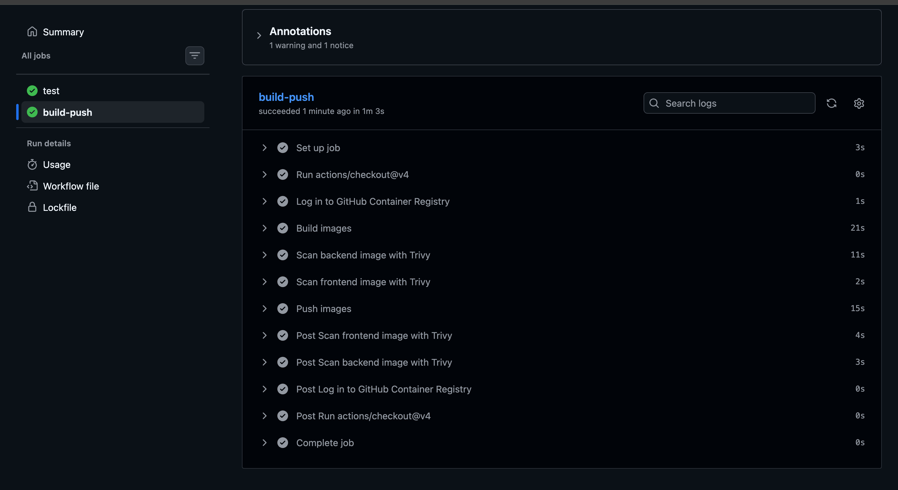

9. Terraform Validation and Deployment
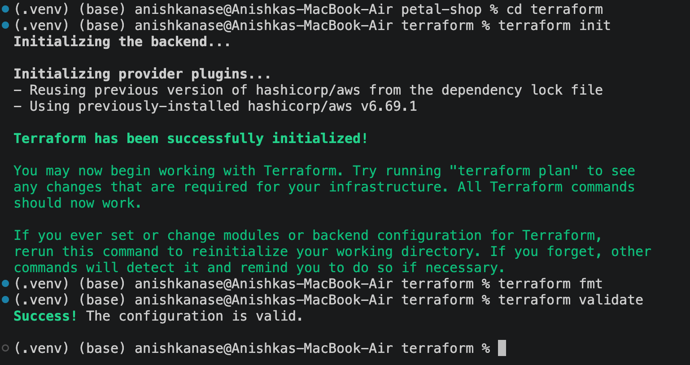

10. Applying terraform plan
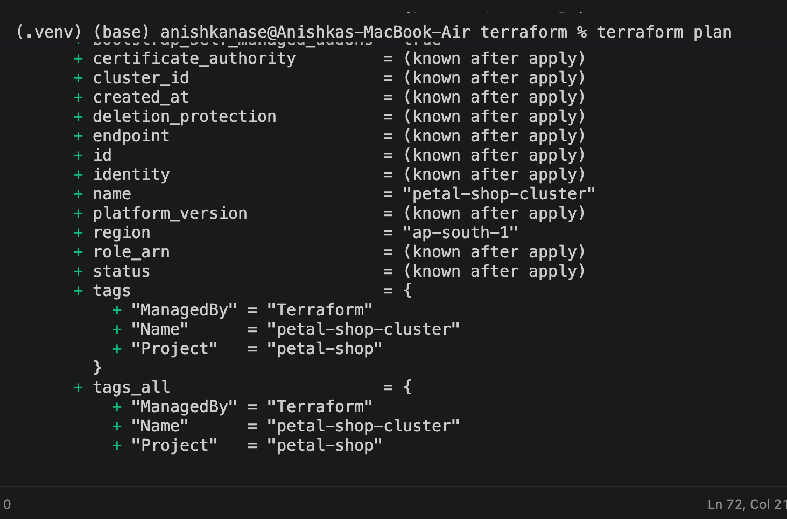

11. Applying terraform
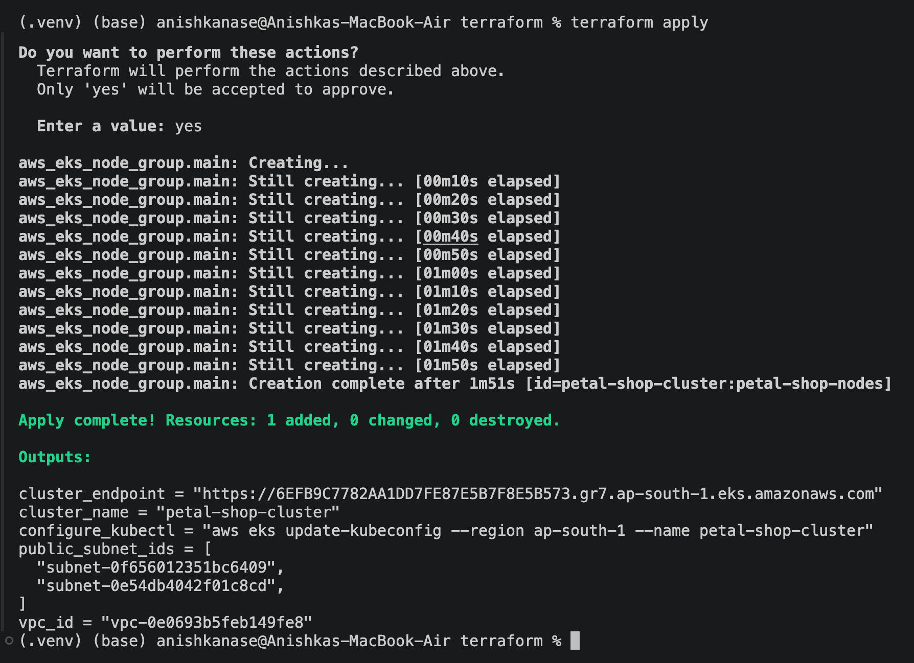

12. 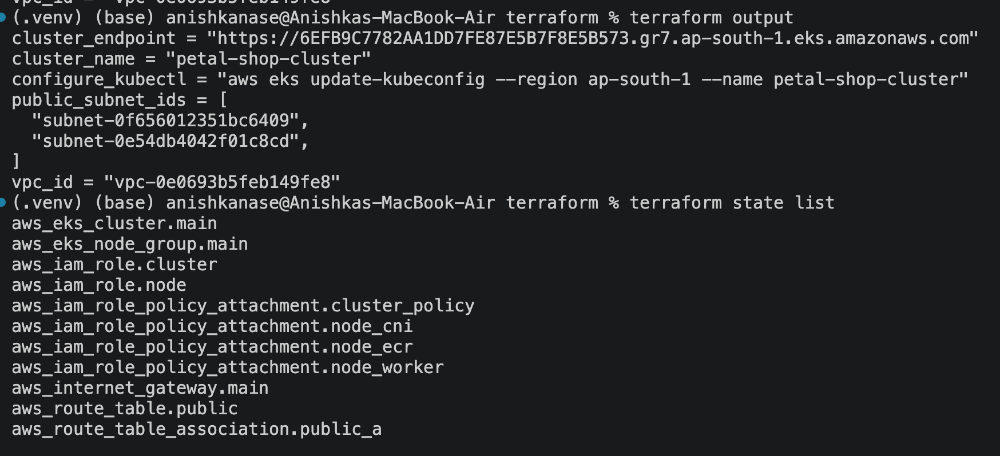
Terraform output and State list.

13. AWS Infrastructure Verification: After successfully applying the Terraform configuration, verified the provisioned AWS resources.
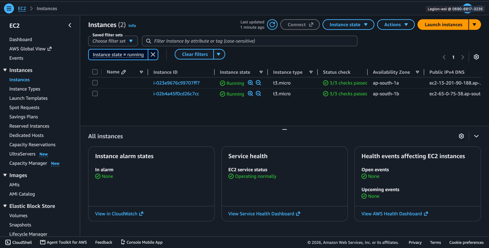 - EC2
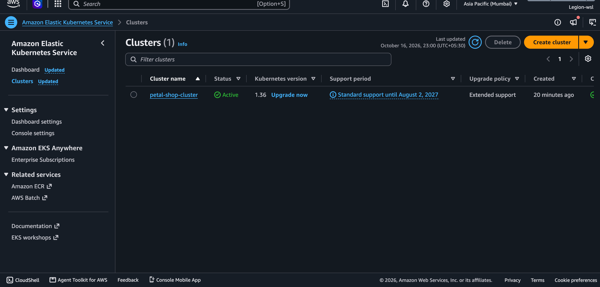 - EKS
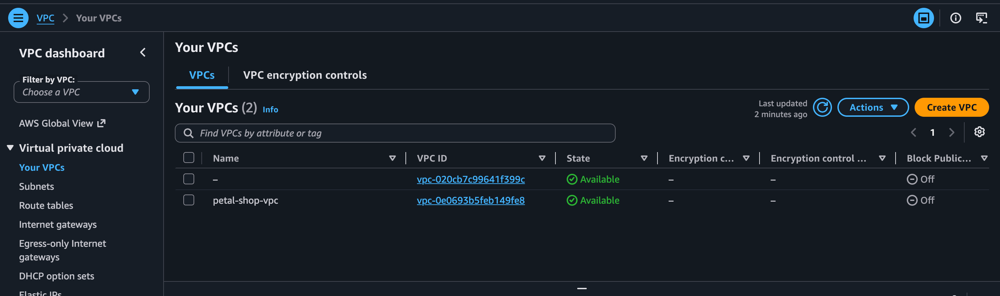 - VPC
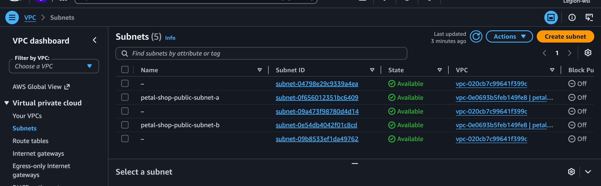 - Subnet
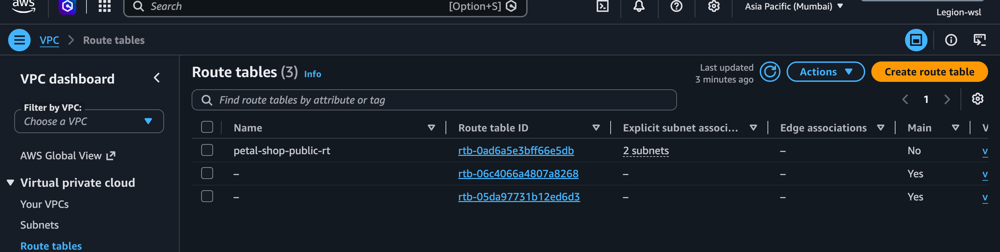 - Route Table
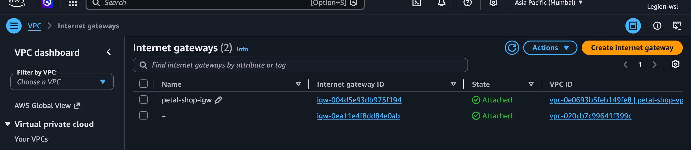 - IGW(Internet Gateway)
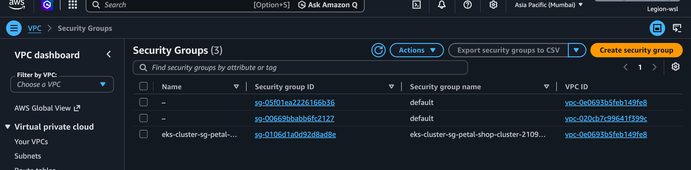 - Security Groups

14. Terraform destroyed
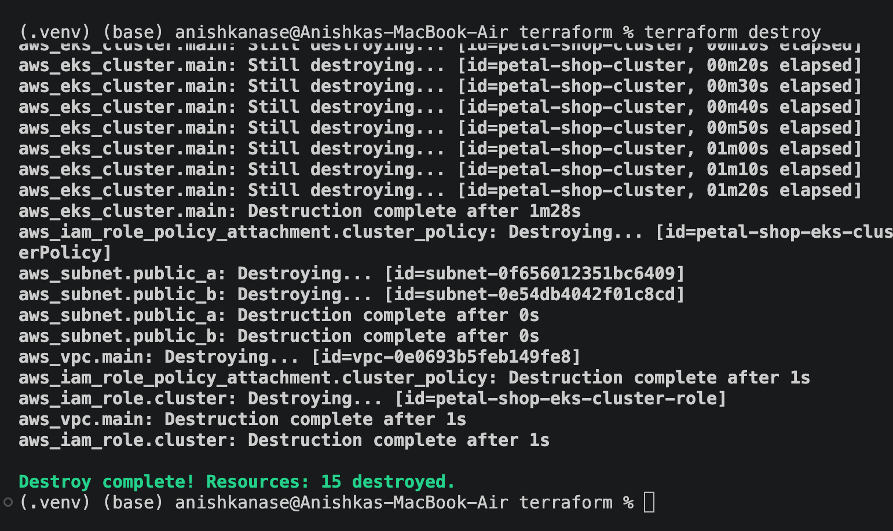

15. Helm install
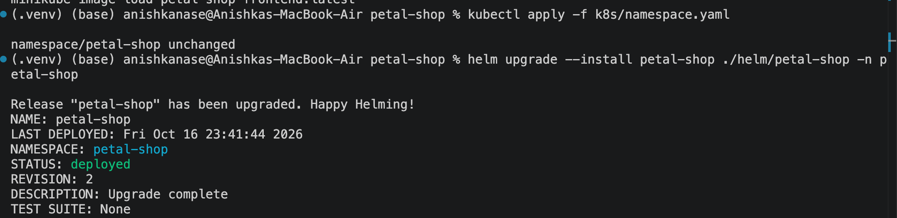

16. Helm get pods and services and helm list
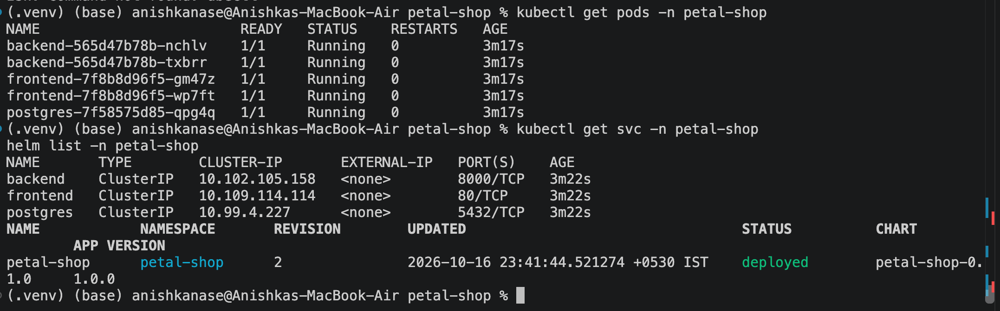

17. kubectl get ingress
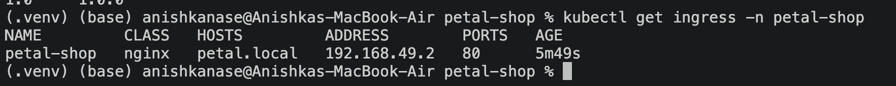

18. Ingress localhost on browser

Video Link inside Drive folde:
https://drive.google.com/drive/folders/1eQ9GsEEKd5uq27uqpHmT0j0bvrJPos4W?usp=sharing